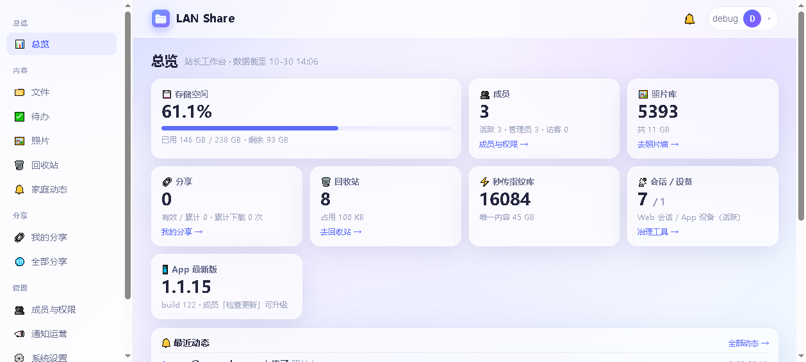
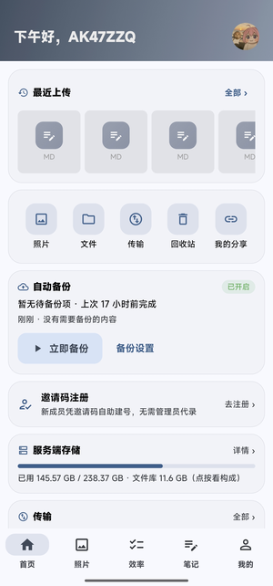
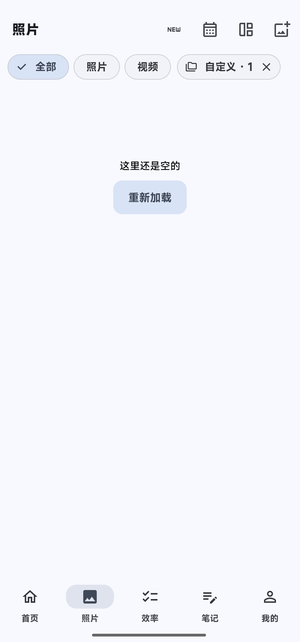
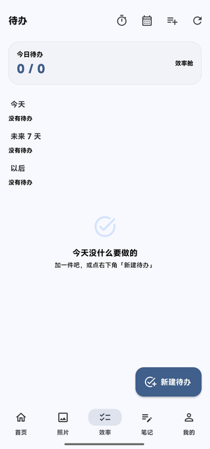
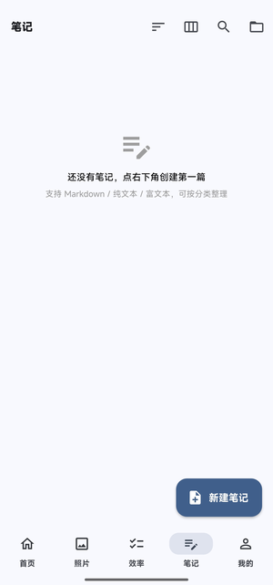
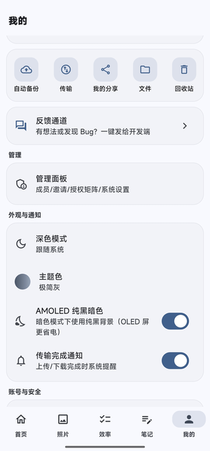
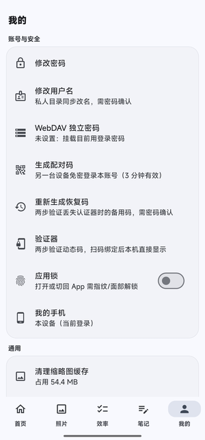

<div align="center">
  <sub><a href="README.en.md">English</a> &nbsp;·&nbsp; <b>简体中文</b></sub>

  
  <h1>LAN Share</h1>
  <p><b>把家里那台吃灰的 Windows 电脑，变成全家人都能用的私有网盘。</b></p>
  <p>不需要公网 IP，不需要买 NAS，不需要把照片交到任何云厂商手上。</p>

  [](https://github.com/AK47ZZQ/lan-share/actions/workflows/ci.yml)
  
  
  
  
  
</div>

---

## 为什么会有这个项目

**商业网盘在收紧。** 免费额度一降再降，下载限速，会员年年涨，说不准哪天就关停。更要紧的是——你的家庭照片、证件扫描件、十年备份，物理上存在别人的机房里。

**自建看起来很美，门槛卡在公网 IP。** 家里宽带在 NAT 后面的大内网里，光猫拨号也拿不到独立 IP。DDNS 指不到你家，域名解析到运营商网关。大多数「自建网盘教程」讲到这一步就没下文了。

**但你家里有一台闲置电脑。** 旧台式、退役笔记本、或者一台小主机——常年插电、24 小时待机、几 T 硬盘，实际上在吃灰。

LAN Share 把这三件事连起来：

> 一台闲置电脑 + 一条内网穿透隧道 = 一个你完全拥有、随时随地能打开的网盘。

数据在你自己的硬盘上，服务在你自己的机器上跑。不续费、不限速、不被扫描，想改什么改什么。

## 它解决什么

不是「把文件夹共享出来」——那个 SMB 就够了。这个项目要解决的是**一家人合用的日常**：

- 手机拍的照片自动备份到家，不用每月插线导出
- 每个人独立账号、独立私人空间，互不可见；共享盘按目录授权
- 分享给亲戚的链接带有效期和提取码，到期自动失效
- 不在家也能访问——局域网和公网功能完全一致，不是阉割版

<p align="center">
  
</p>
<p align="center"><sub>Web 端 · 站长工作台：存储构成、成员与配额、动态流、限速观测</sub></p>

## 手机端

Web 是站长的工作台，App 是家里每个人日常打开的那个。Flutter 原生，不是套壳网页。

<p align="center">
  
  
  
</p>
<p align="center">
  
  
  
</p>
<p align="center"><sub>首页 · 照片时间线 · 待办 · 笔记 · 我的 · 账号与安全</sub></p>

- **相册自动备份**：拍完自动传到家，首页显示上次备份时间，不用记得这件事
- **照片时间线**：三列瀑布流，按 EXIF 拍摄时间归月，可切「照片 / 视频」，右上角跳日历
- **账号与安全在一处**：改密码、WebDAV 独立密码、配对码、恢复码、验证器、应用锁
- **和 Web 完全同源**：同一个后端、同一份权限，手机上删掉的网页端立刻不见

## 前置要求

| 项 | 版本 | 说明 |
|---|---|---|
| 系统 | Windows 10 / 11 | 服务通过 NSSM 注册；Linux/macOS 需改用 systemd，见下方说明 |
| Python | 3.11+ | 后端运行时 |
| PostgreSQL | 16 | 生产数据库（测试可退回 SQLite） |
| Node.js | 18+ | 只构建前端时需要 |
| Caddy | v2 | 反向代理与 TLS，放到 `bin/caddy.exe` |
| NSSM | 2.24+ | 把 Python / Caddy 注册成 Windows 服务 |

所有路径与端口集中在 **`env.bat`** 一个文件里，默认按仓库自身位置推导；装在别处无需改脚本。

## 首次部署

```bash
# 1. 依赖
python -m venv .venv
.venv\Scripts\pip install -r requirements.txt

# 2. 数据库（建库即可，首次启动会自动建表）
createdb -h 127.0.0.1 -p 5433 -U postgres lanshare

# 3. 前端产物（构建一次即可，产物由后端直接挂载）
cd web && npm install && npm run build && cd ..

# 4. 放二进制：caddy.exe 放进 bin\，nssm.exe 放进 PATH
#    下载地址见 docs/OPERATIONS.md「依赖」

# 5. 注册并启动（管理员权限 PowerShell）
.\install-service.bat
net start lan-share-postgresql
net start lan-share-api
net start lan-share-caddy
```

浏览器打开 `https://<本机 IP>:8765`。自签证书首次访问点「继续访问」，首启会引导创建管理员账号，其余成员由管理员发邀请码自助注册。

### 日常启停

```bash
powershell Restart-Service lan-share-api     # 改后端后
powershell Restart-Service lan-share-caddy   # 改 Caddyfile 后
cd web && npm run build                      # 改前端后（不用重启）
check.bat                                     # 改后端必跑的质量门禁
```

| 入口 | 地址 | 认证 |
|---|---|---|
| Web 全站（Vue 3） | `https://<IP>:8765` | 应用层登录 |
| 公网（隧道） | `https://<你的隧道域名>:<端口>` | 同上，功能完全对等 |
| WebDAV | `https://<IP>:8765/dav/` | Basic（成员账号） |
| 健康探针 | `/healthz` | 免认证，仅局域网可达 |

> 公网入口靠隧道打通，细节见 [docs/OPERATIONS.md](docs/OPERATIONS.md)。探针刻意不暴露给公网——那是内部状态，不该让外面探测到。

## 能力

| 领域 | 有什么 |
|---|---|
| **多用户** | admin / member / guest 三角色；私人 + 共享双空间；目录授权矩阵（成员 × 目录，带有效期）；邀请制建号；私人空间配额；停用即全端踢出 |
| **文件** | 网格 / 列表双视图、搜索、最近文件、多选批量；统一预览器（图片缩放旋转、文本 / Markdown / CSV / docx / xlsx / pptx、音视频、HEIC / HEIF + EXIF 矫正） |
| **传输** | 自适应分片（≤2 GB → 5 MB … >10 GB → 64 MB）、断点续传、指纹秒传、并发 3 路、队列暂停恢复、拖拽粘贴批量入队 |
| **分享** | 外链 + 二维码（有效期 / 提取码 / 下载次数上限）、定向分享、目录打包下载 |
| **照片** | 时间线（EXIF 优先）、缩略图懒加载、相册精选、手机端自动备份 |
| **笔记待办** | 分类笔记体系、待办清单、日历视图 |
| **通知** | 站内通知中心、家庭动态流、SSE 实时推送、Webhook（ntfy / Bark / Telegram） |
| **安全** | 应用层认证、可选 TOTP 两步验证、会话与设备治理、审计日志、按入口分账的防爆破 |
| **客户端** | Vue 3 Web（PWA 可离线安装）、Flutter 原生 App（相册自动备份 / 系统分享 / 通知中心） |

完整能力与逐版变更见 [CHANGELOG.md](CHANGELOG.md)（130 KB，按版本倒序）。

## 和其他方案比

|  | LAN Share | Nextcloud | 群晖 DSM | 商业网盘 |
|---|---|---|---|---|
| 需要公网 IP | 否，走隧道 | 建议有 | 需要 | — |
| 硬件成本 | 0（旧电脑即可） | 0（需自备服务器/旧电脑） | 3000 元起 | — |
| Windows 原生 | 是 | 勉强 | 是 | — |
| 代码量 | 可通读 | 百万行级 | 闭源 | 闭源 |
| 数据归属 | 完全自己 | 自己 | 自己 | 厂商 |

**把取舍说清楚**：Nextcloud 功能多得多，是成熟产品，跟着它走没有错。这个项目只为「一台 Windows 机器 + 一家人」这个场景优化，砍掉企业级特性，把代码量压到能自己读懂、能自己改的程度。你要能随手改的自留地，还是开箱即用的全家桶——自己判断。

## 不适合谁

诚实一点，这几种情况别用：

- **要企业级能力**（LDAP / 合规审计 / S3 后端 / 多节点）—— 用 Nextcloud 或 MinIO
- **要开箱即用**——这套要自己装 Python、PostgreSQL、Caddy，还得会用管理员 PowerShell
- **没有 Windows 机器**——服务脚本是 `.bat` + NSSM，Linux 上要自己写 systemd unit
- **要 iOS 客户端**——`mobile/ios/` 有工程但未构建验证，目前只发布 Android APK

## 架构

```
                         ┌───────────────────────────────┐
外网设备 ──隧道 :8767──▶ │  Caddy v2（TLS / 反代 / 鉴权） │
内网设备 ──局域网 :8765─▶│  剥离入站 XFF，注入入口标记     │
                         └───────────────┬───────────────┘
                                         │
        ┌────────────────────────────────┼────────────────────────────┐
        ▼                                ▼                            ▼
  /files/* 先 forward_auth         /api/* /dav/* /s/*           /assets/* →
  再交后端判权下载                /up /preview/* /thumb/*      web/dist
  （不 file_server 直挂，          ──▶ FastAPI :8766           （Vue 3 SPA
   否则越权读他人 private/）            │                       + 深链回退）
                                        ├─ PostgreSQL 16 :5433
                                        ├─ data/ 数据目录
                                        ├─ 限速 / CSRF / 防爆破 / 审计
                                        └─ SSE 实时事件
```

**后端** FastAPI + uvicorn · **网关** Caddy v2（原生无插件）· **数据库** PostgreSQL 16 + psycopg（生产）/ SQLite（测试）
**前端** Vue 3 + Vite + TypeScript · **App** Flutter（Dio + Riverpod + sqflite + secure_storage）
**图像** Pillow + pillow-heif（HEIC / EXIF）· **其他** pyotp（TOTP）、qrcode、ffmpeg（可选）

## 项目规模

```
后端 app/       12,628 行      68 个模块（api 29 · services 14 · store 11）
Web  src/        6,789 行      Vue 3 + TypeScript
App  lib/       29,172 行      Flutter
测试 tests/     10,571 行      65 个文件 · 560 项
API 契约        143 路径 / 167 操作   （contracts/openapi.json）
```

同一套测试可在 SQLite 与 PostgreSQL 上跑（临时 schema 隔离）。本地门禁 `check.bat` 八段：pytest 基线 + ruff + mypy + pip-audit + UI 分层守卫 + SQLite 方言守卫 + 文档基线守卫 + 安全消融。

## 文档

| 你要什么 | 读哪 |
|---|---|
| 完整 API | [docs/API.md](docs/API.md) |
| 安全模型 | [docs/SECURITY.md](docs/SECURITY.md) |
| 运维（服务 / 备份 / 证书 / 故障） | [docs/OPERATIONS.md](docs/OPERATIONS.md) |
| 开发环境与命令 | [docs/DEVELOPMENT.md](docs/DEVELOPMENT.md) |
| 目录结构 | [docs/PROJECT-LAYOUT.md](docs/PROJECT-LAYOUT.md) |
| App 视觉规范 | [docs/DESIGN-v3/APP-VISUAL-SPEC.md](docs/DESIGN-v3/APP-VISUAL-SPEC.md) |
| 版本历史 | [CHANGELOG.md](CHANGELOG.md) |

<details>
<summary><b>常见问题</b></summary>

| 问题 | 处理 |
|---|---|
| 证书不受信任 | 自签证书所致，点「继续访问」；或把 `certs/cert.pem` 导入系统根证书 |
| 忘记管理员密码 | 清空 users 表后用 `/api/setup` 重建（仅空表开放，首用户即 admin），成员账号由管理员邀请重建 |
| 成员如何加入 | 管理 → 邀请 → 生成邀请码 → 对方在登录页「使用邀请码加入」 |
| 公网分享打不开 | 确认复制的是公网链接（管理面板需先配置公网访问地址），隧道要在线 |
| Windows 映射网络驱动器失败 | 原生 WebClient 对自签证书苛刻，改用 RaiDrive / WinSCP |
| 改了前端没生效 | Ctrl+F5 强刷一次；之后资产文件名带哈希自动更新 |
| 公网看不到健康探针 | 设计如此——探针仅局域网可达，不在公网暴露内部状态 |
| `install-service.bat` 报找不到 nssm | 把 `nssm.exe` 放进 PATH，或设置环境变量 `LANSHARE_NSSM` 指向它 |

</details>

## 许可

[GNU AGPL-3.0](LICENSE)。

你可以自由地使用、修改、自建部署，也可以基于它做自己的东西。唯一的硬约束：**如果你把它改造后作为网络服务提供给他人使用，你的修改也必须以 AGPL-3.0 开源。** 自己家里用、内部用，不受这条约束。

`data/`、`env/`、`.venv/`、凭据与证书均不入库（见 `.gitignore`）。
